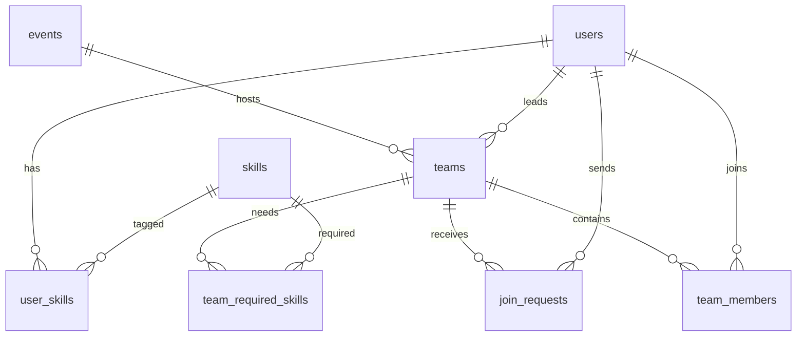

# TeamUp: Hackathon & Project Team Matchmaker

A web app where students find teammates with complementary skills for hackathons.
Stack: **Flask + SQLite** (schema is standard SQL, so it ports to PostgreSQL/MySQL), vanilla JS front end, pure-Python cosine similarity.

## Run locally
```bash
pip install -r requirements.txt
python seed.py 300          # creates matchmaker.db with 300 synthetic students (Faker)
python app.py               # http://localhost:5000
```
Demo login: `demo@univ.edu` / `password123` (every seeded user has this password).
Two demo accounts let you test both sides of a request:
* `demo1@univ.edu` is Aarav, a backend developer without a team.
* `demo2@univ.edu` is Diya, a designer who leads "Demo Squad" in Smart India Hackathon (it needs Python, Django, SQL).
Log in as Aarav and request to join, then log in as Diya and accept from My dashboard. The login dialog has one-click demo buttons.

## Features
Find teammates (multi-filter search), team search by name, event pages, smart recommendations, requests and invites, leave team, leader can remove members, dashboard, insights.

## Deploy for real students
```bash
export SECRET_KEY="long-random-string"
export DB_PATH=/var/data/matchmaker.db      # persistent disk
gunicorn -w 1 -b 0.0.0.0:$PORT app:app
```
* **Render / Railway / PythonAnywhere:** point to this folder, start command `gunicorn app:app`, attach a persistent disk for `DB_PATH`.
* For real use, do **not** run `seed.py` (it deletes the DB). Create the empty schema once:
  `python -c "import sqlite3;sqlite3.connect('matchmaker.db').executescript(open('schema.sql').read())"` and add events/skills via SQL.
* Before launch: serve over HTTPS, restrict sign-up to your university email domain (one `if` in `/api/register`), add an admin to create events.
* Scaling beyond one server: move to PostgreSQL (`AUTOINCREMENT` → `SERIAL`, `RAISE(ABORT)` triggers → PL/pgSQL, `BEGIN IMMEDIATE` → `SELECT ... FOR UPDATE`).
* Real data instead of Faker: replace `make users` loop in `seed.py` with a CSV reader (e.g. past hackathon rosters). Only use data you are permitted to collect.

## ER diagram


## Where each DBMS concept appears
| Concept | Where |
|---|---|
| Normalisation (3NF), M:N junction tables | `user_skills`, `team_required_skills` |
| Constraints (PK/FK/CHECK/UNIQUE) | `schema.sql`: gender, level 1-5, team size, status enums |
| One team per event per student | `UNIQUE(event_id, user_id)` on `team_members` |
| Partial unique index | `uq_pending_request`: one *pending* request per team/user |
| Triggers | `trg_block_full_team`, `trg_member_added`, `trg_member_removed` keep `current_size`/`status` correct when people join, leave or are removed |
| View | `v_skill_gap` (demand vs supply) |
| Indexes | `idx_user_skills_skill`, `idx_users_filters` |
| Multi-filter JOIN + GROUP BY/HAVING | `/api/users/search`: "has ALL these skills" uses `HAVING COUNT(DISTINCT skill_id) = n` |
| Subqueries / NOT EXISTS | free-agent filter, analytics |
| ACID transaction | `respond()` in `app.py` (below) |
| Recommendation engine | `recommender.py` |

### The accept-invite transaction (`BEGIN IMMEDIATE ... COMMIT`)
1. Lock the database for writing (two leaders can't take the last seat simultaneously).
2. Insert into `team_members`. Triggers reject a full team, then bump `current_size` and set `status='full'`.
3. Mark the request `accepted`.
4. Close all of that student's other pending requests in the same event.
5. If the team is now full, close its remaining pending requests.
Any failure runs `ROLLBACK`, so the data never ends up half-updated.

### Recommendation engine
Every skill is a dimension. User vector = proficiency/5; team vector = skills the team **still needs** (required minus those already covered by members at level ≥ 3). Score = cosine similarity. SQL first pre-filters candidates that own at least one needed skill, then Python ranks the top 5. This works both ways: top-5 teammates for a team, and top-5 teams for a student.

## Ideas to extend (for extra marks)
Jaccard/weighted score with availability + year, `leave team`, email notifications, admin panel, EXPLAIN QUERY PLAN comparison with and without indexes, concurrent-accept stress test.
